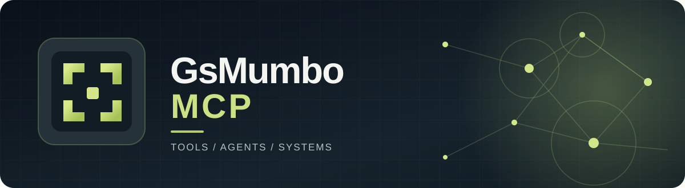
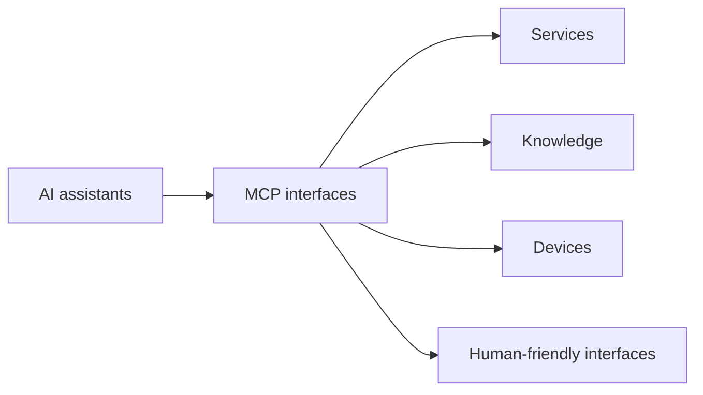

### Connected intelligence, built with deliberate boundaries.

An independently developed ecosystem exploring **Model Context Protocol integrations**, personal automation, connected assistants and reliable tooling.

**Tools** · **Agents** · **Systems** · **Model Context Protocol**

---

## The idea

An assistant becomes more useful when it can interact with real services while respecting the boundaries between knowledge, execution and permission. GsMumbo-MCP explores that idea through focused connectors, reusable components and practical automation.

| 🧩 Integrations | 🧠 Agent workflows | 🔐 Trust by design |
|:--|:--|:--|
| Narrow, understandable tools for real services. | Coordinated tasks and useful interfaces. | Explicit identities, permissions and operational limits. |

## What we're building toward

## Engineering principles

- **Least privilege.** A connector receives only the access it needs.
- **Clear boundaries.** Reading, changing and administering systems are distinct capabilities.
- **Durable source of truth.** Documentation tracks source ownership, versions and deployment provenance.
- **Verifiable behavior.** Tests, issue milestones and live acceptance are reported separately.
- **Human control.** Consequential operations should remain reviewable and understandable.

> [!NOTE]
> Most project repositories are private. This public overview intentionally doesn't publish internal service inventories, private repository links, infrastructure details or operational endpoints.

---

GsMumbo-MCP · A personal laboratory for practical, responsible AI integrations.

